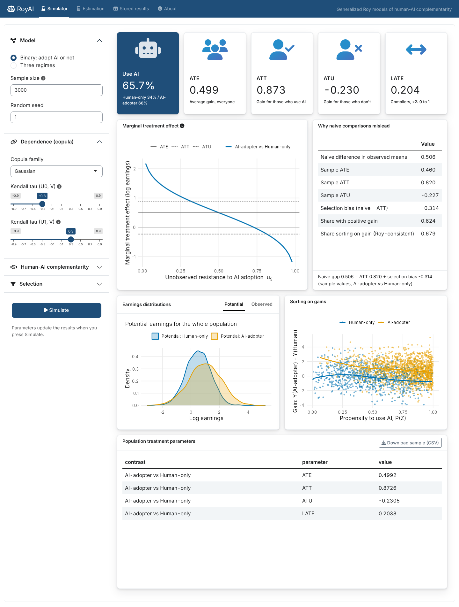

# RoyAIapp: interactive research platform for RoyAI

A Shiny application (bslib, Bootstrap 5, Shiny modules) built on the `RoyAI` package. It has six tabs.

| Tab | What it does |
|---|---|
| **Simulator** | You set the copula family (Gaussian, Student-t, Clayton, Gumbel, Frank), Kendall's tau for each regime, AI productivity premium, AI-skill complementarity, earnings dispersion, adoption cost, instrument strength, sample size and seed, for the binary model or three regimes. It shows the adoption share, the population ATE/ATT/ATU/LATE (`roy_te_truth()`), the true MTE curve, potential and observed earnings distributions, sorting on gains, and how the naive gap splits into ATT plus selection bias. You can download the simulated sample. |
| **Estimation** | Fits `roy()` to the simulator sample, a PIAAC-shaped synthetic example (`piaac_example()` + `piaac_onet_prep()`), or an uploaded CSV. Model A uses full ML across the copula families you tick (multistarted) or the two-step estimator; Model B uses MNL + Dubin-McFadden. It shows a family comparison (AIC, BIC, Akaike weights, ATE/ATT/ATU with SEs), coefficients, the multistart log, the estimated MTE (overlaid on the truth for simulator data) and `roy_diagnostics()`. You can download the comparison CSV and the fits (.rds). |
| **Intensity (Model D)** | Simulates AI use as a censored intensity in [0, 1) with a copula between the outcome shock and the pull towards AI, fits `roy_continuous()` (multistarted for non-Gaussian families), and compares the dose-response E[Y(a)], the effects of more intensity for workers at a given intensity (TT), for everyone (ATE) and for non-users (TUT) with the truth and with naive OLS. Shows the parameter table and the multistart log. |
| **Dynamics (Model E)** | Simulates a panel in which workers learn their complementarity with AI from AI earnings and acquire it by doing, fits `roy_dynamic()` by CCP or nested fixed point, and shows observed vs fitted adoption, a myopic counterfactual, ATE/ATT/ATU over time against the true gains and the naive gap, and the share of adopters who adopt for option value. |
| **Stored results** | The Paper 1 Monte Carlo study: RMSE, bias and coverage by n, family and estimator; Tables 1-5 and the weak-instrument table; Figure 1 MTE; the Model D and Model E recovery tables. The PIAAC Cycle 2 copula application: effects by family and specification, the multistart refits, and the first-run log. |
| **About** | The model in brief, and package versions. |



## Install and run (RStudio / Positron)

```r
# install.packages("remotes")
remotes::install_github("brassbe1982/RoyAIapp")   # also installs brassbe1982/RoyAI
RoyAIapp::run_royai_app()
```

During development, open the `RoyAIapp/` folder and run the root `app.R` (it calls `pkgload::load_all()`). The Positron or RStudio "Run App" button works on that file.

**Deployment** (Posit Connect, shinyapps.io, Shiny Server): install both packages on the server and deploy `inst/app/app.R`, which calls `RoyAIapp::run_royai_app()`.

To read live results instead of the bundled copies, run `options(royai.results_dir = "<dir>")` first. The folder must contain `montecarlo/` and `piaac/` in the same layout as `inst/extdata/results/`.

## Structure

```
R/
  app.R            theme, page_navbar shell, server, run_royai_app()
  mod_simulator.R  simulator module (returns the simulated scenario as a reactive)
  mod_estimate.R   estimation module (takes the simulator reactive)
  mod_modelDE.R    Model D and Model E labs
  mod_results.R    stored Monte Carlo and PIAAC results
  fct_simulate.R   sim_params(), simulate_scenario(), true_mte()   - pure R, tested
  fct_estimate.R   fit_families(), compare_fits(), is_regular()   - pure R, tested
  fct_plots.R      ggplot builders (Okabe-Ito palette)
  fct_modelDE.R    run_modelD(), run_modelE() and their plots       - pure R, tested
  fct_results.R    locating and reading stored results
inst/app/www/      CSS
inst/extdata/results/  bundled copies of the MC tables and PIAAC copula results
tests/testthat/    unit tests for fct_* and shiny::testServer() tests for the modules
dev/e2e_playwright.js  headless browser run used to verify the app (Node + Playwright)
```

Business logic lives in `fct_*` functions with no reactivity, so it can be tested and reused outside Shiny. Modules only wire inputs to those functions.

## A safeguard in the estimation tab

Copula likelihoods can spike at a boundary (|tau| close to 1). There the optimizer reports convergence, but the Hessian is not positive definite. `roy()`'s multistart can keep such a point because its log-likelihood is highest. The app therefore checks every fit with `is_regular()`. If a multistarted fit is irregular, the app refits from the default start and keeps that run when it is regular, and the "note" column says so. Irregular fits are ranked last and get no Akaike weight. Example: a Clayton DGP with tau = (-0.3, 0.7) and n = 3000 (seed 1). The Frank fit from the flipped-tau start reaches tau1 = 0.98, and its log-likelihood beats the true Clayton model by 300 points.

## Tests

```r
devtools::test()   # 54 expectations: simulator truth vs sample analogues for all five
                   # families, MTE integrates to ATE, estimation paths, module server tests
```

## Reference publication

This package is part of the RoyAI project, which builds on the following peer-reviewed publication:

> Niankara, I., Aljallad, Y., Soussi, O., Maghrabi, K., Alkhyeli, M. and Alghool, S. (2025). *The Impact of Artificial Intelligence on Fresh Graduate Labor Demand: A Theoretical and Empirical Analysis with Industry and Firm Heterogeneity.* In 2025 Global Congress on Emerging Technologies (GCET), Lyon, France, 2-5 December 2025. IEEE. [doi:10.1109/GCET68529.2025.11450624](https://doi.org/10.1109/GCET68529.2025.11450624). Open version: [BRASS Digital Lab](https://brassbe1982-bdlweb.share.connect.posit.cloud/research/ai-graduate-labor-demand-agentic.html).

`citation("RoyAIapp")` prints this reference and the software citation in BibTeX.

## Author and funding

Ibrahim Niankara (author, maintainer; Ibrahim.niankara@aau.ac.ae). Funded by BRASS Digital Lab, an LLC registered in Burkina Faso (RCCM BF-OUA-01-2026-B13-02466; https://brassbe1982-bdlweb.share.connect.posit.cloud/).
